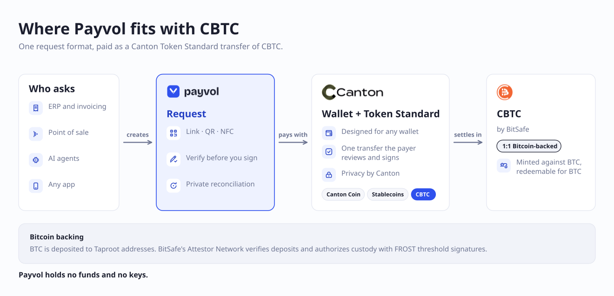
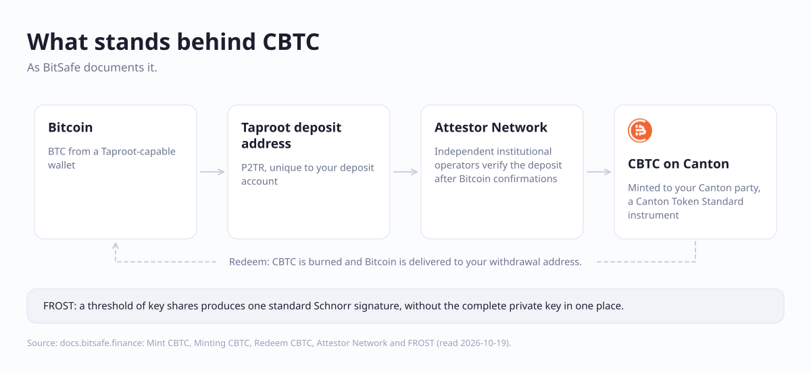
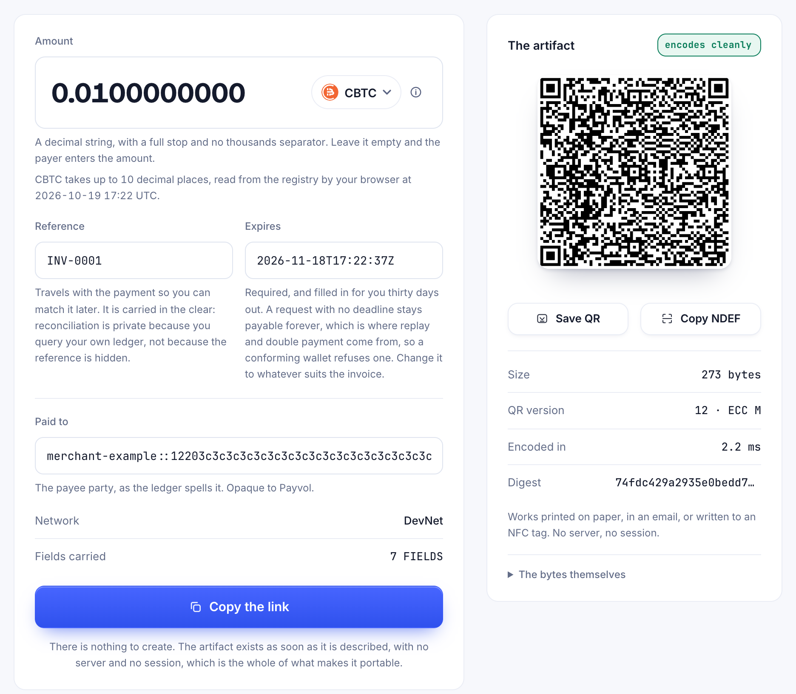
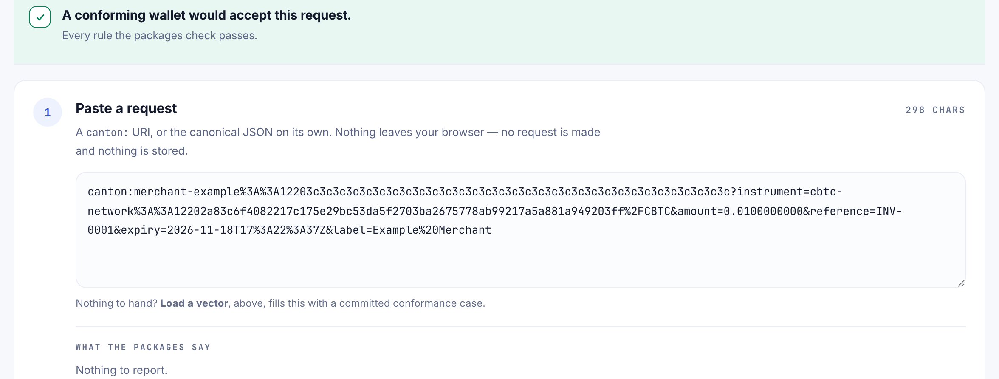
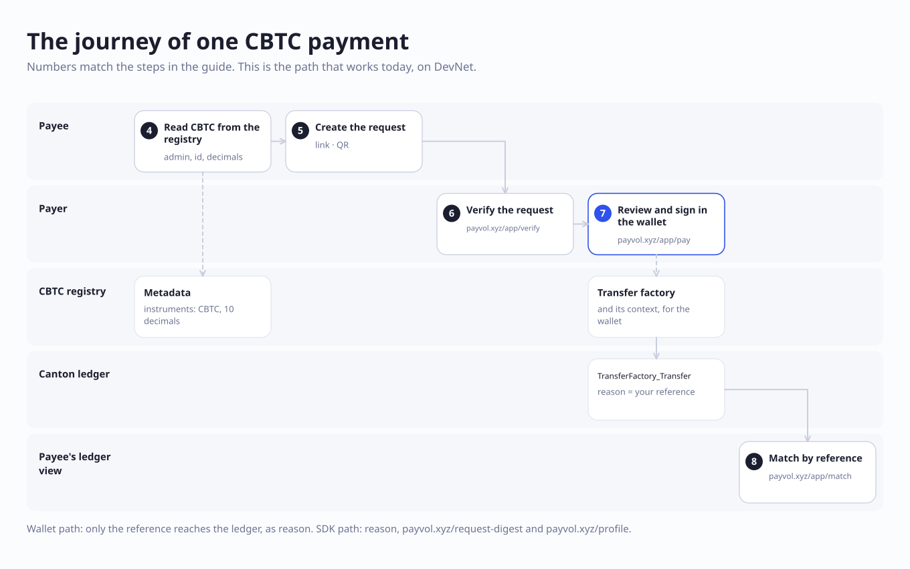
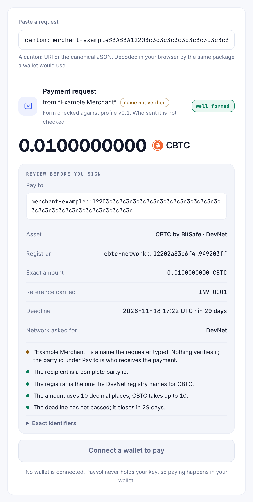
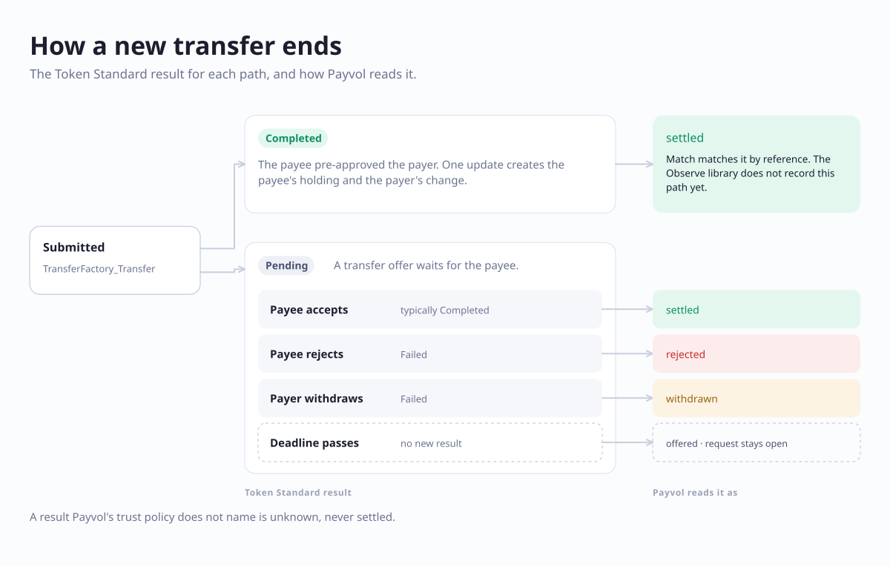
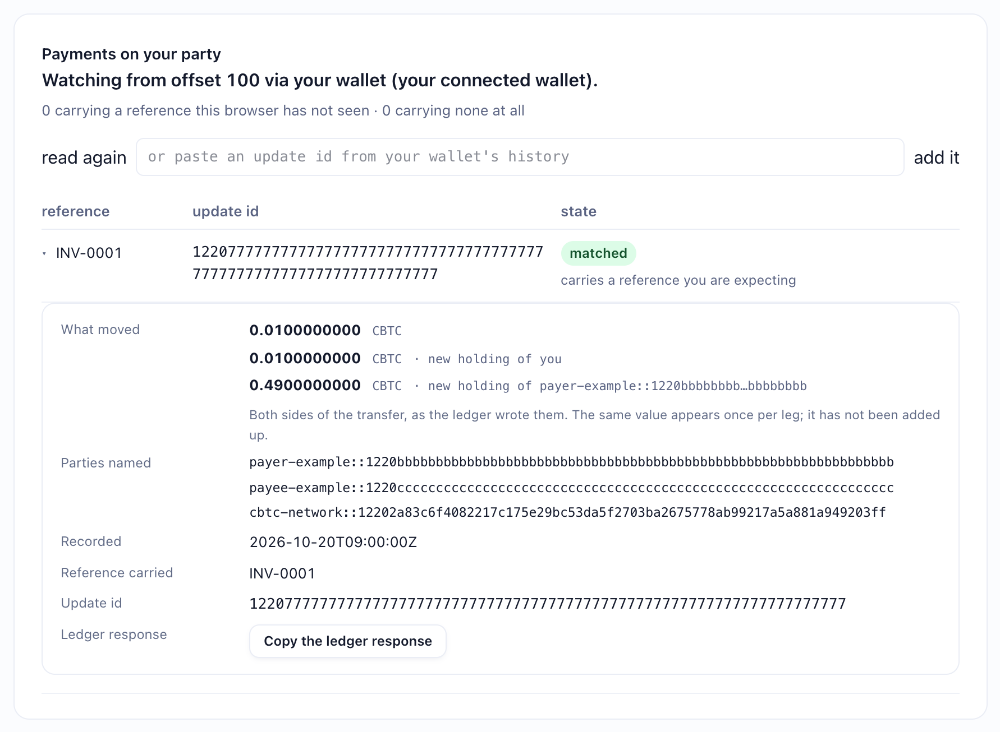
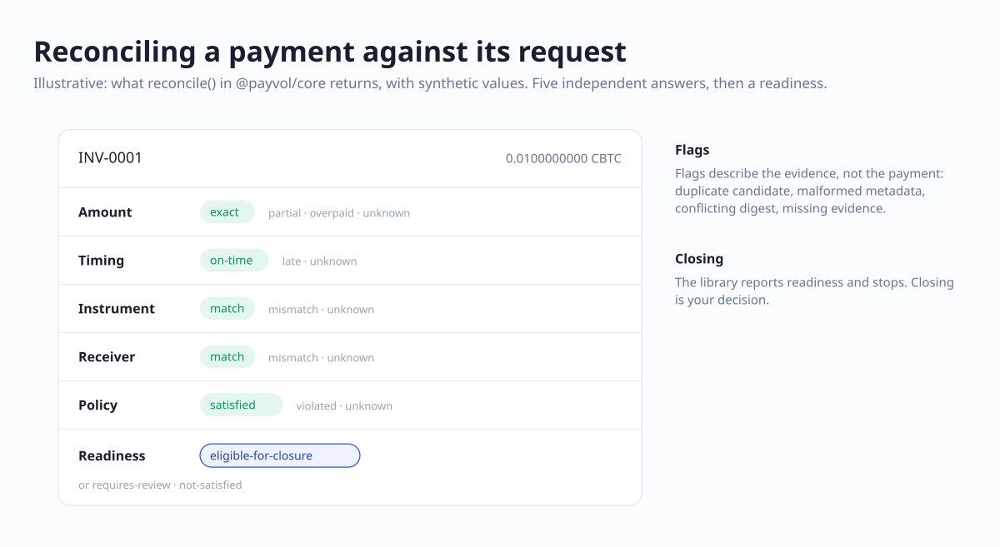

# Accept CBTC with Payvol

Ask for a CBTC payment with a link or a QR code, let the payer check it before they sign, and match
the payment to your invoice on your own ledger. This guide walks through it on DevNet, first in the
browser and then in code.

<picture>
  <source media="(max-width: 700px) and (prefers-color-scheme: dark)" srcset="diagrams/1-vision-narrow-dark.svg">
  <source media="(max-width: 700px)" srcset="diagrams/1-vision-narrow-light.svg">
  <source media="(prefers-color-scheme: dark)" srcset="diagrams/1-vision-wide-dark.svg">
  
</picture>

*Where Payvol is designed to fit: the request in the middle. It holds no funds and no keys.*

## Your first payment in five minutes

You need two DevNet wallets: one to pay from, one to be paid into.

1. **Get test CBTC.** Open the [BitSafe faucet](https://cbtc-faucet.bitsafe.finance/?network=devnet&token=cbtc),
   paste the paying wallet's party ID, and request CBTC. If it arrives as an offer, accept it in that wallet.
2. **Ask to be paid.** On [payvol.xyz/app/request](https://payvol.xyz/app/request), choose **CBTC**, enter
   `0.01`, the reference `INV-0001`, and the receiving wallet's party ID. Press **Copy the link**.
3. **Pay.** Open the link, or paste it on [payvol.xyz/app/pay](https://payvol.xyz/app/pay). Read the
   review, press **Connect a wallet to pay**, choose the paying wallet, and approve the transfer there.
4. **Match it.** On [payvol.xyz/app/match](https://payvol.xyz/app/match), in the same browser, connect
   the receiving wallet.

**Expected result:** a row with `INV-0001`, marked **matched**, and the CBTC that moved.

The rest of this guide explains each step, and how to do the same from code.

## 1. What CBTC is

CBTC is a Bitcoin-backed token on the Canton Network, issued by [BitSafe](https://bitsafe.finance).
It is a Canton Token Standard (CIP-0056) instrument, served by the Digital Asset Utility Registry. Payvol
treats it like any token-standard instrument: an admin party and an id. BitSafe's documentation,
[docs.bitsafe.finance](https://docs.bitsafe.finance/), is the authority on CBTC itself.

<picture>
  <source media="(max-width: 700px) and (prefers-color-scheme: dark)" srcset="diagrams/5-backing-narrow-dark.svg">
  <source media="(max-width: 700px)" srcset="diagrams/5-backing-narrow-light.svg">
  <source media="(prefers-color-scheme: dark)" srcset="diagrams/5-backing-wide-dark.svg">
  
</picture>

*What stands behind CBTC, as BitSafe documents it.*

## 2. What you need

| For | You need |
|---|---|
| The browser path | A DevNet wallet that can pay a CIP-0056 transfer (see below), and the party ID of the receiving wallet |
| The code path | Node.js 20.19.0 or later, and for paying and observing, a Canton participant with its JSON Ledger API and a party on it |

A **party ID** looks like `name::1220` followed by 64 hexadecimal characters. Copy it whole: a
shortened party ID is the most common reason a payment cannot be made.

**Wallets, as of 2026-10-19.** Payvol hands the transfer to the wallet through PartyLayer.

- **Loop** has paid a CBTC request through Payvol on DevNet.
- **Console** and **Nightly** implement the same transfer call in their PartyLayer adapters, and
  have not been tried with CBTC.
- **Walley** received that payment, and Match read it through Walley. Walley's adapter has no
  transfer call, so Walley cannot send a payment through Payvol today.

## 3. Get test CBTC

BitSafe runs a faucet for DevNet and TestNet.

1. Open the [faucet with DevNet and CBTC selected](https://cbtc-faucet.bitsafe.finance/?network=devnet&token=cbtc).
2. Enter the receiving party ID and request test tokens.
3. If the tokens arrive as an offer, accept it in the wallet. BitSafe notes that the receiving
   participant must have the DA Utility Registry installed. Both wallets used for this guide, Loop
   and Walley, received CBTC on DevNet.

**Expected result:** the wallet shows a CBTC balance. Faucet tokens are not MainNet assets.

## 4. Read CBTC's identity from the registry

Never type CBTC's admin party, id or decimals into your code. Read them from the registry, refresh
them every few minutes, and warn when they change. BitSafe states that the admin and id can change
with upgrades and that nothing announces it ([Instrument ID Management](https://docs.bitsafe.finance/developers/instrument-id-management.md)).

The [example project](../examples/cbtc) does this for you. Set it to DevNet first, so the requests it
builds match the app:

```sh
cd examples/cbtc
npm install && npm run build
cp .env.example .env
export NETWORK=devnet           # or set NETWORK=devnet in .env
npm run refresh-metadata
```

**Expected result:** JSON with `"network": "devnet"`, the DevNet registry, CBTC's admin party,
`"id": "CBTC"`, `"decimals": 10` and `"source": "registry"`.

The identity per network, as BitSafe publishes it and as the registry answered on 2026-10-18:

| Network | Registry | Admin party |
|---|---|---|
| MainNet | `https://api.utilities.digitalasset.com` | `cbtc-network::12205af3b949a04776fc48cdcc05a060f6bda2e470632935f375d1049a8546a3b262` |
| TestNet | `https://api.utilities.digitalasset-staging.com` | `cbtc-network::12201b1741b63e2494e4214cf0bedc3d5a224da53b3bf4d76dba468f8e97eb15508f` |
| DevNet | `https://api.utilities.digitalasset-dev.com` | `cbtc-network::12202a83c6f4082217c175e29bc53da5f2703ba2675778ab99217a5a881a949203ff` |

The instrument id is `CBTC` on all three. The metadata lives at
`{registry}/api/token-standard/v0/registrars/{admin}/registry/metadata/v1/instruments`.

## 5. Create a payment request

A Payvol request is a `canton:` URI. The same bytes can be a link, a QR code or an NFC tag.

**In the browser.** On [payvol.xyz/app/request](https://payvol.xyz/app/request), choose CBTC. The page
reads CBTC's decimals from the registry and refuses an amount with more.



**In code.**

```sh
npm run create-request -- \
  --recipient payvol-demo-recipient::1220abababababababababababababababababababababababababababababababab \
  --amount 0.0100000000 --expiry 2027-01-01T00:00:00Z --reference INV-0001 --qr
```

**Expected result:** JSON with `"network": "devnet"`, the `uri`, a `web+canton:` `link` and the
request's `digest`, then a QR code. Replace the placeholder recipient with the real party ID. An amount
with more than 10 decimal places is refused, never rounded: a rounded amount would be a different
request.

## 6. Verify the request

Anyone can check a request before paying it. Verification reads it the way a wallet would, and checks
it against what the registry says CBTC is on this network.

**In the browser.** Paste it on [payvol.xyz/app/verify](https://payvol.xyz/app/verify).



**In code.**

```sh
npm run verify-request -- '<the canton: URI from step 5>'
```

**Expected result:** `"valid": true` **and** `"warnings": []`. Read the warnings: a request for
something that calls itself CBTC under another party is valid as a request and comes back with an
`ADMIN_NOT_CBTC_REGISTRAR` warning. Keep the single quotes, because the URI contains `?` and `&`. The
same URI read with `NETWORK=mainnet` is refused with `NOT_THIS_NETWORK`, because each network's CBTC
has its own registrar.

## 7. Pay

<picture>
  <source media="(max-width: 700px) and (prefers-color-scheme: dark)" srcset="diagrams/2-journey-narrow-dark.svg">
  <source media="(max-width: 700px)" srcset="diagrams/2-journey-narrow-light.svg">
  <source media="(prefers-color-scheme: dark)" srcset="diagrams/2-journey-wide-dark.svg">
  
</picture>

*One payment, lane by lane. The step numbers are this guide's.*

### With a wallet

Paste the request on [payvol.xyz/app/pay](https://payvol.xyz/app/pay). The page shows what signing would
do before any wallet is involved: who is paid, the asset, the exact amount, the reference and the
deadline. The name in the request is the requester's own words. Payvol marks it **name not verified**:
check the party ID, not the name.



Press **Connect a wallet to pay**, choose your wallet, and approve the transfer in it. The wallet builds
the transfer with the registry and shows it to you again. Payvol never sees your key.

**Expected result:** Pay reads the transfer back and says **Paid.** when it completed, or **Offered,
and nothing has moved yet.** when it is waiting for the payee to accept. On this path, the request's
reference reaches the ledger as the Token Standard's `reason`, and nothing else from Payvol does: the
PartyLayer adapters for Console, Loop and Nightly accept a memo and no other metadata.

### With the SDK, on your own participant

```sh
npm run pay -- '<the canton: URI>'
```

`pay` refuses a request this network's CBTC cannot pay. It then picks holdings, asks the registry for
the transfer factory, **prints the transfer command it will submit**, and submits only after you type
`yes`. For an external party, your participant prepares the transaction and `pay` signs the hash it
returns without decoding it, so this path trusts your own participant to prepare what you reviewed.

**Expected result:** an `updateId`. Keep it: the payee needs it in step 8. The transfer carries three
values: `splice.lfdecentralizedtrust.org/reason` (your reference), `payvol.xyz/request-digest` and
`payvol.xyz/profile`. Anyone who can read the transfer can read them.

## 8. See the payment and match it to the invoice

What the payee sees depends on how the transfer ended.

<picture>
  <source media="(max-width: 700px) and (prefers-color-scheme: dark)" srcset="diagrams/3-outcomes-narrow-dark.svg">
  <source media="(max-width: 700px)" srcset="diagrams/3-outcomes-narrow-light.svg">
  <source media="(prefers-color-scheme: dark)" srcset="diagrams/3-outcomes-wide-dark.svg">
  
</picture>

*How a transfer ends, and how Payvol reads each ending.*

**In the browser.** On [payvol.xyz/app/match](https://payvol.xyz/app/match), connect the receiving
wallet in the browser that issued the request. Match reads your own party's view of the ledger through
the wallet and marks each payment that carries a reference this browser issued.



**Expected result:** `INV-0001`, marked **matched**. Open the row to see what moved, by holding and
owner.

**In code.** For a payment that arrived as an offer, the example records it on your own participant
with `@payvol/core`:

```sh
npm run instructions                                         # the open offers you can see
npm run resolve -- <instructionId> accept                    # prints the accept updateId
npm run trust-from-updates -- <offerUpdateId> <acceptUpdateId>
npm run observe -- '<the canton: URI>' <offerUpdateId> <acceptUpdateId>
```

`<offerUpdateId>` is the `updateId` the payer's `pay` printed in step 7. `<acceptUpdateId>` is the one
`resolve` printed. `trust-from-updates` needs only one offer and its acceptance, once.

**Expected result:** the outcome's lifecycle, `settled`, and four checks against the request: the
digest, the receiver, the instrument, and whether the amount covers it.

<picture>
  <source media="(max-width: 700px) and (prefers-color-scheme: dark)" srcset="diagrams/4-reconcile-narrow-dark.svg">
  <source media="(max-width: 700px)" srcset="diagrams/4-reconcile-narrow-light.svg">
  <source media="(prefers-color-scheme: dark)" srcset="diagrams/4-reconcile-wide-dark.svg">
  
</picture>

*What `reconcile()` in `@payvol/core/draft02` returns, with synthetic values. The example's `observe`
prints four of these checks.*

## 9. Move to MainNet

- **Use MainNet's identity, from the registry.** The admin party differs on each network; set
  `NETWORK=mainnet` and let the example read it. Never mix the networks: a TestNet admin in a MainNet
  request is a different instrument, and `verify-request` refuses it.
- **Real CBTC comes from real Bitcoin.** There is no faucet. Most payers will hold CBTC they received
  by transfer. Minting it against BTC needs a Minter credential from BitSafe, as
  [Mint CBTC](https://docs.bitsafe.finance/cbtc/guides/mint-cbtc.md) describes.
- **The app at payvol.xyz asks wallets for DevNet only today.** On MainNet, use the code path.

## 10. Troubleshooting

| You see | Do this |
|---|---|
| Loop: "Action failed: Prepared transaction not found" when you press Confirm | In Loop's settings, switch the theme to **Classic** and pay again. Seen on DevNet on 2026-10-19 with Loop's New theme, where Classic worked. |
| Loop opens an unexpected wallet address | Loop's wallet is at `wallet.devnet.looptech.io` since `@fivenorth/loop-sdk` 0.15.0. Use loop-sdk 0.15.0 or later; payvol.xyz ships 0.15.1. |
| "too many decimals", or `AMOUNT_BEYOND_DECIMALS` | The amount has more decimal places than the registry gives CBTC (10). Shorten it. Payvol never rounds. |
| The payment went through but no offer appeared | The payee had pre-approved this payer, so the payment completed at once. Match shows it today. The Observe library in `@payvol/core` does not record this path yet. |
| Only your reference reached the ledger | That is the wallet path: the wallet carries the reference, as `reason`, and nothing else. The request's digest and profile reach the ledger on the SDK path. |

## Sources

| Claim | Source |
|---|---|
| CBTC's admin party and registry per network, and that the admin and id can change | BitSafe, [Instrument ID Management](https://docs.bitsafe.finance/developers/instrument-id-management.md); the registry's own `/registry/metadata/v1/info` and `/instruments` answers, committed in [`examples/cbtc/fixtures/registry`](../examples/cbtc/fixtures/registry) |
| CBTC has 10 decimal places | The same registry answers, 2026-10-18 |
| The faucet, DevNet and TestNet only; the receiving participant needs the DA Utility Registry | BitSafe, [Integrations](https://docs.bitsafe.finance/cbtc/guides/integrations.md) |
| Taproot (P2TR) deposit addresses, unique to a deposit account | BitSafe, [Minting CBTC](https://docs.bitsafe.finance/product-suite/assets/cbtc/operational-guides/minting-cbtc.md) |
| The Attestor Network, FROST, minting, the Minter credential, redeeming | BitSafe, [Attestor Network and FROST](https://docs.bitsafe.finance/cbtc/concepts-and-reference/attestor-network-and-frost.md), [Mint CBTC](https://docs.bitsafe.finance/cbtc/guides/mint-cbtc.md), [Redeem CBTC](https://docs.bitsafe.finance/cbtc/guides/redeem-cbtc.md) |
| Offers, acceptance, and transfers that complete without acceptance | BitSafe, [Transfer and receive CBTC](https://docs.bitsafe.finance/cbtc/guides/transfer-and-receive-cbtc.md); the Token Standard's `TransferInstructionV1` (results Pending, Completed, Failed), in the [Splice repository](https://github.com/canton-network/splice) |
| Which wallets carry the transfer call, and that they carry only a memo | The published PartyLayer adapters: `@partylayer/adapter-loop` 0.5.1, `@partylayer/adapter-console` 0.4.0 and `@partylayer/adapter-nightly` 0.3.0 implement `requestTransfer` with a memo only; Walley comes through `@partylayer/sdk` 0.19.0's announce adapter, which has none |
| Loop paid CBTC through Payvol; that payment completed in one step and matched | A DevNet payment on 2026-10-19, read on the payee's own ledger view |
| Loop's new wallet address | `@fivenorth/loop-sdk` 0.15.0 on npm; [fivenorth-io/loop-sdk](https://github.com/fivenorth-io/loop-sdk) release v0.15.0 |
| What the SDK path puts on the ledger | `examples/cbtc/src/transfer.ts` |
| What `reconcile()` returns | `@payvol/core` 0.4.0, `draft02` |
